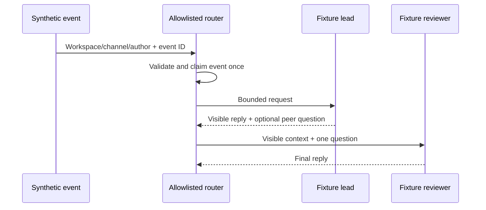

# Governed Slack collaboration

**Version 1.0** · 2026-11-13

A bounded employee handoff with inspectable routing and failure behavior.
`coordinator.py` is the exact working Employee Hub coordinator; `routing.py`
contains exact selected event/admission/delivery functions. Both come from the
private AI OS engineering layer, with hashes in [PROVENANCE.json](PROVENANCE.json).
All events, employee definitions, model replies and messages here are synthetic.

```sh
python3 -B -m unittest discover -s tests -v
python3 -B demo.py
```

Python 3.10+; standard library only. No Slack SDK, provider API, credential,
network transport, event listener or live conversation is included.

The fixture routes one allowed human mention to an Operations Lead. The lead
returns a structured reply and may ask one roster peer one question. The peer
receives the visible lead message and gives a final reply in the same thread.
Malformed handoffs are rejected before the lead message is posted. Event IDs
are admitted once through a SQLite receipt before any model or send effect.



Tests cover wrong workspace, channel, author, bot input, shared-channel input,
replayed events, invalid handoffs, output escaping and uncertain sends.
An admitted event stays recorded if delivery fails: this prevents automatic
duplicate sends but can leave a partial conversation. This is at-most-once
admission, not exactly-once delivery. The operator must reconcile an uncertain
result before deciding how to recover. [Tests](tests/test_collaboration.py).

Working proof: offline routing, one bounded handoff, context propagation and
receipt behavior. Proposed acceptance: token-identity checks in the live adapter,
provider calls, service supervision, automatic live triggers, both peer directions,
and recipient evidence. Fixture replies establish none of those deployment claims.

This extends the evidence coverage beyond the earlier
[RoboManager Slack showcase](https://github.com/markyafi1991/robomanager-slack),
which demonstrates a different manager-bot architecture. It does not replace it.
See [report connection](REPORT.md), [claim map](evidence-map.json),
[publication review](PUBLICATION_REVIEW.md) and [decisions](DECISIONS.md).
